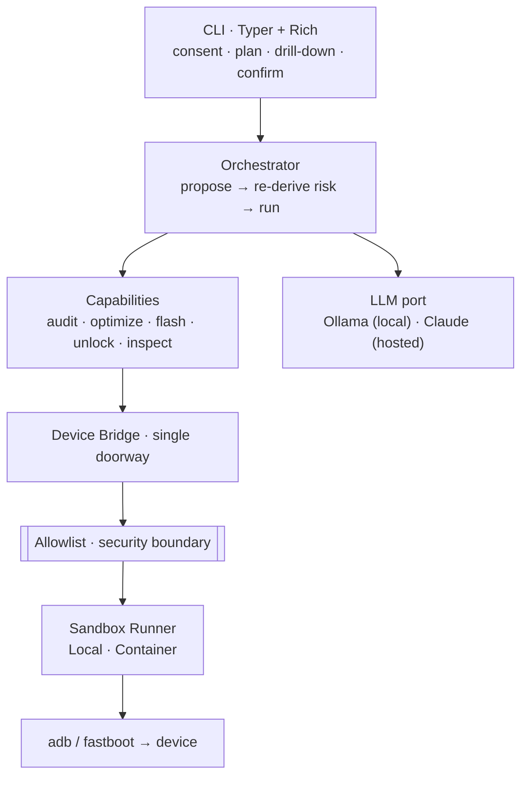

# android-agent


An LLM-driven agent that helps you **audit, optimize, flash and unlock _your own_
Android device** — sandboxed, with clear human-language explanations, and with
your confirmation before anything changes.

It puts a local or hosted LLM between what you *want* ("my phone is slow", "I
want to install LineageOS", "which apps are spying on me?") and the technical
`adb`/`fastboot` commands — translating in both directions, and letting you
**drill down** to the exact command whenever you want to see it.

> ⚠️ **Scope.** android-agent operates only on a device you own and have
> physically connected, after you confirm an on-screen consent gate. It does
> **not** help bypass lock screens, Factory Reset Protection (FRP), carrier
> locks, or the security of a device you don't own. That is out of scope by
> design, and the code refuses it.

## Contents

- [Why](#why) · [Quickstart](#quickstart) · [How it works](#how-it-works)
- [Missions](#the-four-missions) · [Commands](#command-reference)
- [LLM backends](#llm-backends) · [Sandbox](#the-container-sandbox)
- [Configuration](#configuration) · [Security model](#security-model)
- [Status](#status) · [Documentation](#documentation) · [License](#license)

## Why

Power-user Android maintenance — debloating, auditing permissions, flashing a
custom ROM, unlocking a bootloader — is powerful but intimidating and easy to get
wrong. android-agent makes it **explainable and safe-by-default**: read-only
first, reversible where possible, a plain-language plan you approve, and a hard
confirmation before anything destructive.

## Quickstart

```bash
# 1. Install (pip, or uv for a locked environment)
pip install -e ".[anthropic]"        # or: uv sync --all-extras

# 2. Make sure platform-tools are available
adb version && fastboot --version

# 3. Plug in your device (USB debugging on) and list it
android-agent devices

# 4. A safe, read-only audit to start
android-agent run audit "which apps can use my microphone?" -s <SERIAL> --drill-down
```

No device handy? Every command is covered by tests with fake devices; see
[docs/TESTING.md](docs/TESTING.md) for the on-device checklist.

## How it works



Three principles make it safe:

1. **Two-phase contract.** The LLM never runs anything. It proposes a `Plan` of
   steps, each with a plain-language description and a risk level. You see the
   plan, optionally `--drill-down` into the raw commands, and confirm. HIGH-risk
   plans need an extra explicit yes.
2. **Allowlist.** Every command is an `argv` list (never a shell string) checked
   against an explicit per-tool allowlist before the bridge runs it. The LLM
   cannot cause arbitrary shell to execute, which also neutralizes prompt
   injection arriving from the device itself.
3. **Authoritative risk.** A step's risk is re-derived from its command via the
   allowlist — the model's self-declared risk is never trusted, so a plan can't
   understate how dangerous a step is to dodge the confirmation.

More diagrams (sequence, trust boundaries): [docs/DIAGRAMS.md](docs/DIAGRAMS.md).

## The four missions

| Mission | What it does | Mode | Risk |
|---|---|---|---|
| **audit** | List apps, flag mic/camera/location grants, find bloatware. | adb | None (read-only) |
| **optimize** | Disable bloatware (reversible), review top battery drainers. | adb | Low, reversible |
| **flash** | Guided ROM/firmware flash with model verification. | fastboot | High |
| **unlock** | `fastboot flashing unlock` on *your own* device (erases data). | fastboot | High |

Each mission requires the right connection mode; the agent refuses (with a clear
message) if the device is in the wrong one.

## Command reference

| Command | What it does |
|---|---|
| `android-agent devices` | List connected devices (adb + fastboot). |
| `android-agent run <mission> "<request>" -s <SERIAL>` | LLM-planned mission (audit/optimize/flash/unlock). |
| `android-agent debloat -s <SERIAL>` | Deterministic (no-LLM) detection & reversible disabling of likely bloatware. |
| `android-agent flash-rom -s <SERIAL> --product <codename> --image <part>=<path> ...` | Verified, ordered, guarded ROM flash. |
| `android-agent log [-s <SERIAL>]` | Review the recorded action trail. |

Common flags: `--drill-down` (show raw commands), `--runner local|container`,
`--log/--no-log`, `--llm ollama|anthropic`.

```bash
# Audit what can spy on you
android-agent run audit "which apps can use my microphone or camera?" -s R58... --drill-down

# Reversibly disable preinstalled bloatware (review the list before confirming!)
android-agent debloat -s R58... --drill-down

# Flash LineageOS (device must be in fastboot, bootloader unlocked, backed up)
android-agent flash-rom -s R58... --product redfin \
  --image boot=boot.img --image system=system.img --image vbmeta=vbmeta.img

# See exactly what the agent did
android-agent log -s R58...
```

## LLM backends

Pick either, swap freely — same interface:

- **Ollama (local, default).** Your device's data never leaves the machine.
  Needs a local Ollama server; set the model with `ANDROID_AGENT_OLLAMA_MODEL`.
- **Claude API (hosted).** More capable planning. Install the extra
  (`pip install -e ".[anthropic]"`) and set `ANTHROPIC_API_KEY`; select it with
  `--llm anthropic` or `ANDROID_AGENT_LLM=anthropic`.

## The container sandbox

`--runner container` runs `adb`/`fastboot` inside a **network-less** container so
a compromised toolchain or a malicious device payload can't reach the host or the
internet.

- **Linux:** USB passthrough (`--device=/dev/bus/usb`), no network.
- **Windows / macOS:** the container talks to the host's adb server over the
  Docker/Podman gateway (USB can't be passed through directly there).

Build the image once:

```bash
docker build -t android-agent/adb-tools:latest -f docker/adb-tools.Dockerfile .
```

## Configuration

All optional; sensible defaults are used.

| Variable | Default | Purpose |
|---|---|---|
| `ANDROID_AGENT_LLM` | `ollama` | LLM backend: `ollama` or `anthropic`. |
| `ANDROID_AGENT_OLLAMA_MODEL` | `llama3.1` | Ollama model name. |
| `OLLAMA_HOST` | `http://localhost:11434` | Ollama server URL. |
| `ANTHROPIC_API_KEY` | — | Required for the hosted backend. |
| `ANDROID_AGENT_RUNNER` | `local` | `local` or `container`. |
| `ANDROID_AGENT_ADB` | (PATH) | Explicit path to the `adb` binary. |
| `ANDROID_AGENT_FASTBOOT` | (PATH) | Explicit path to the `fastboot` binary. |
| `ANDROID_AGENT_LOG` | per-user log dir | Path to the action-log file. |

Tool lookup uses `shutil.which`, so `adb` resolves to `adb.exe` on Windows via
`PATHEXT` and via normal PATH on Linux/macOS — no per-OS config needed.

## Security model

Carried by two mechanisms, enforced at one chokepoint each:

- **Command allowlist** (`bridge/allowlist.py`) — `argv` only, `shell=False`,
  explicit per-tool sub-commands, shell metacharacters rejected, risk derived
  here. Neutralizes prompt injection from the device.
- **Consent / ownership gate** (`consent.py`) — per-serial authorization is
  required before any capability executes, and the authorized serial is injected
  into every command so an action can only hit that one device.

Plus: two-phase propose→confirm→execute, an extra yes for HIGH-risk steps, strict
flash-target verification, an append-only action log, and an optional network-less
container sandbox. Full analysis in [docs/THREAT_MODEL.md](docs/THREAT_MODEL.md)
and the red-team pass in [docs/ADVERSARIAL_REVIEW.md](docs/ADVERSARIAL_REVIEW.md).

**Found a vulnerability?** Please report it privately — see [SECURITY.md](SECURITY.md).

## Status

Early **alpha**. Architecture, the security boundary, the two-phase flow, device
discovery, all five commands, the container sandbox and flash verification are in
place and covered by the test suite (ruff + mypy clean, CI on Windows + Linux).

A 360° audit on 2026-11-04 (AMBER; 0 critical, 5 High, all since fixed) and a
red-team pass informed the current security hardening — see
[`audits/`](audits/) and [docs/ADVERSARIAL_REVIEW.md](docs/ADVERSARIAL_REVIEW.md).

The one thing the suite can't cover is a physical phone — unit/CLI tests use fake
bridges. See [docs/TESTING.md](docs/TESTING.md) for the manual on-device
checklist. Open refinements are tracked in [CHANGELOG.md](CHANGELOG.md) and the
issue tracker.

## Documentation

- [Architecture](docs/ARCHITECTURE.md) — layers, C4 views, patterns, invariants
- [Diagrams](docs/DIAGRAMS.md) — context, layers, sequence, trust boundaries
- [Architecture Decision Records](docs/adr/README.md)
- [Threat model](docs/THREAT_MODEL.md) — STRIDE analysis
- [Adversarial review](docs/ADVERSARIAL_REVIEW.md) — red-team pass
- [Testing](docs/TESTING.md) — automated suite + manual on-device checklist
- Audit reports: [`audits/`](audits/)
- [Security policy](SECURITY.md) · [Contributing](CONTRIBUTING.md) ·
  [Code of Conduct](CODE_OF_CONDUCT.md) · [Changelog](CHANGELOG.md)

## License

Apache-2.0. See [LICENSE](LICENSE).

> Flashing firmware and unlocking a bootloader can erase your data and void your
> warranty. You run this on your own hardware, at your own risk.
