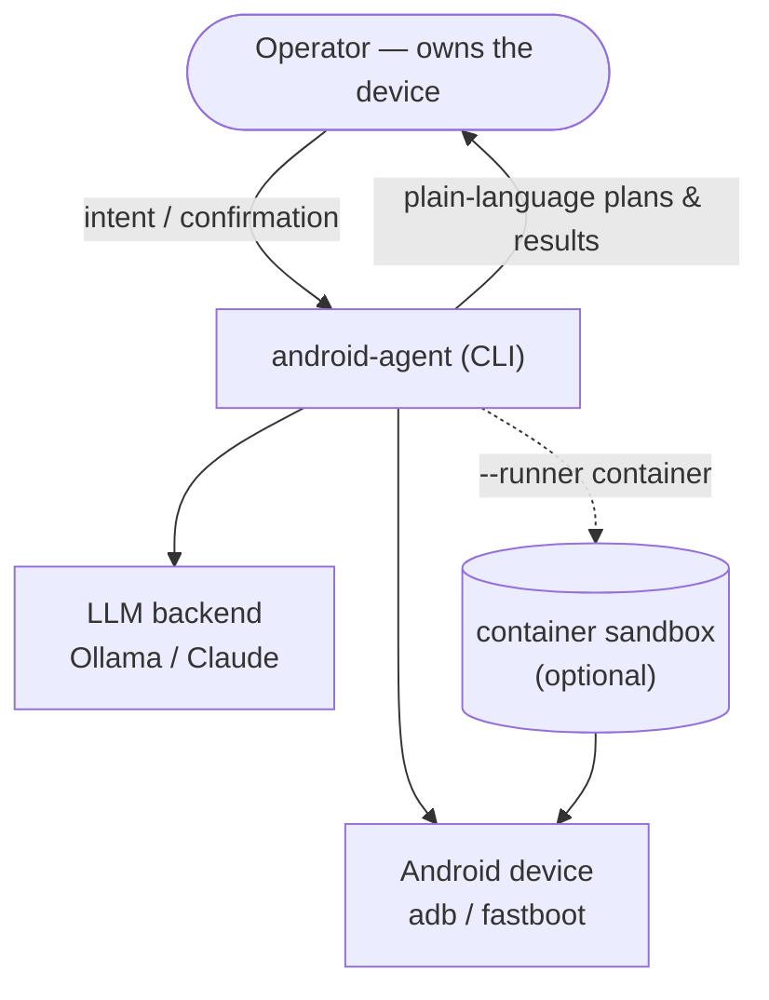
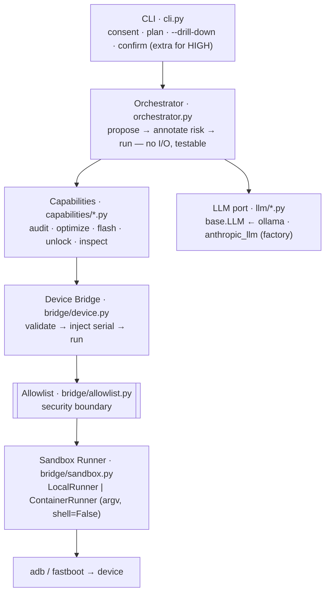
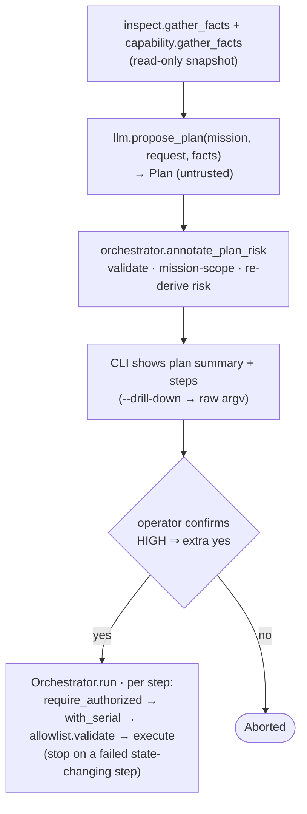

# Architecture

android-agent is a layered, ports-and-adapters design. Each layer depends only
on the one below it through a narrow interface, which keeps the security
boundary in one place and makes every external dependency (the LLM, the device
toolchain) swappable and testable.

## C4 — Context

## C4 — Container / layers

## The core contract: propose → confirm → execute

## Design patterns used

- **Ports & Adapters (Hexagonal).** `llm.base.LLM` and `sandbox.Runner` are
  ports; Ollama/Anthropic and Local/Container are adapters. The core
  (orchestrator, capabilities) depends on the ports only.
- **Strategy.** The LLM backend and the sandbox runner are interchangeable
  strategies chosen at runtime by a factory / config.
- **Command.** A `Step` is a validated, self-describing command object (with a
  human description, risk, and an `undo`); a `Plan` is a sequence of them.
- **Facade.** `Bridge` is the single facade over the device toolchain; nothing
  else calls `subprocess`.
- **Guard clause / policy at the boundary.** `allowlist.validate` and
  `consent.require_authorized` are enforced at the chokepoint, not sprinkled.

## Key invariants (do not break)

1. The LLM output is untrusted; it can only ever result in an **allowlisted**
   command, and each step's **risk is derived from the allowlist**
   (`allowlist.risk_for`), never trusted from the model.
2. Commands are `argv` lists, executed with `shell=False` — never shell strings.
3. No capability runs without `require_authorized(device)`.
4. Every executed command targets the authorized serial (`with_serial`).
5. The orchestrator performs no I/O and asks no questions — the CLI (or a future
   UI) owns all interaction, so the core stays unit-testable.

## Where decisions are recorded

Architecture Decision Records live in [`docs/adr/`](adr/). Start with
[the index](adr/README.md).
