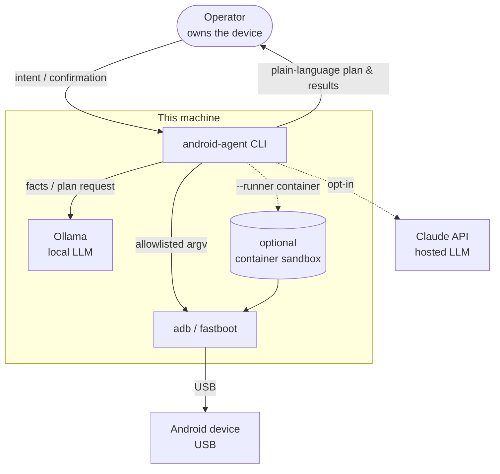
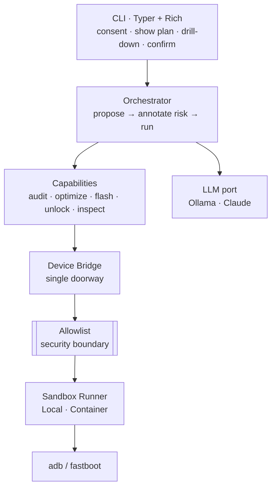
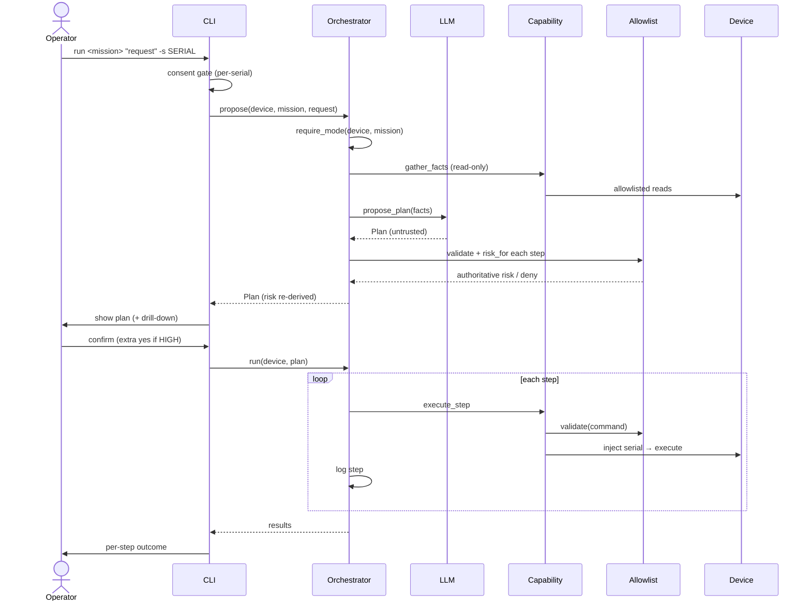
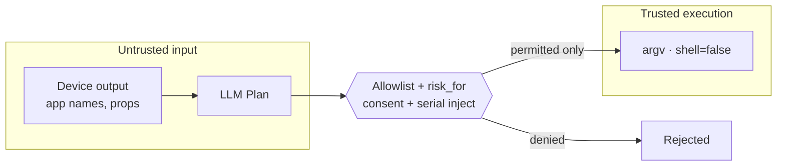

# Diagrams

Rendered by GitHub automatically (Mermaid). They complement the prose in
[ARCHITECTURE.md](ARCHITECTURE.md).

## System context (C4 level 1)

## Layers / containers (C4 level 2)

## The propose → confirm → execute flow

## Trust boundaries (data flow)

