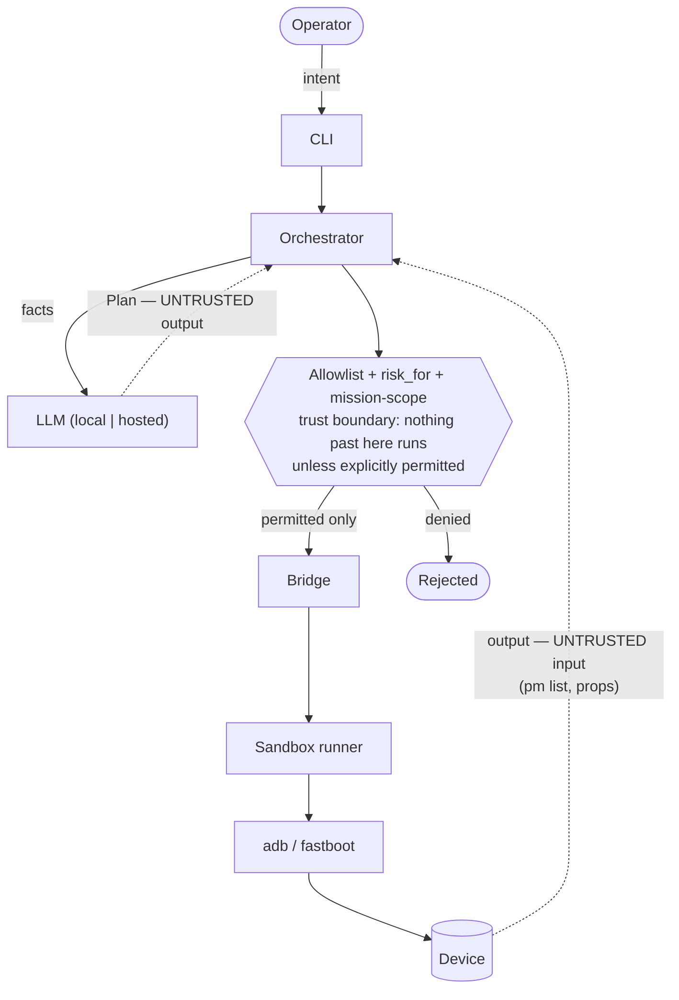

# Threat Model

A STRIDE-oriented look at android-agent. The system takes an operator's
natural-language intent, asks an LLM (local or hosted) to propose a plan, and
executes allowlisted `adb`/`fastboot` commands against the operator's own
device.

## Assets

| Asset | Why it matters |
|---|---|
| The connected device & its data | Flashing/unlock can erase it or brick it. |
| The host machine | The toolchain runs here; a bad command must not harm it. |
| Device data read during audit | May include package lists, properties — kept local by default. |
| The operator's API key (hosted LLM) | Secret; must not leak to logs or the device. |

## Trust boundaries

The **LLM output** and the **device output** are both treated as untrusted.

## STRIDE

### Spoofing
- *Wrong device targeted.* Mitigation: the authorized serial is injected into
  every command (`with_serial`); the LLM cannot redirect an action to another
  serial, and the consent gate is per-serial.

### Tampering
- *LLM proposes a destructive/arbitrary command.* Mitigation: the allowlist
  validates every `argv` by **shape and arguments** — the sub-command must match
  a key AND its arguments must satisfy a per-key validator (regex per position,
  fail-closed), so free-form arguments can't carry shell syntax that `adb shell`
  would re-parse on the device. Shell-significant characters are also rejected
  outright. (This argument layer was added after the 2026-11-04 audit found the
  original check validated only the sub-command prefix — see `audits/`.)
- *Malicious data on the device influences the plan* (prompt injection via an
  app name, property, etc.). Mitigation: device output is data, never executed;
  any command it tries to induce still has to pass the allowlist.
- *LLM understates risk or smuggles a command into an off-mission plan.*
  Mitigation: `annotate_plan_risk` re-validates every proposed step against the
  allowlist and re-derives its risk from the command (`allowlist.risk_for`)
  before the user confirms — the LLM's self-declared risk is never trusted over
  the allowlist, and a non-allowlisted command rejects the whole plan.

### Repudiation
- *No record of what ran.* Mitigation: an append-only action log
  (`audit_log.py`) records the consent acknowledgement, proposed plan, explicit
  confirmation and every executed step per device. It is **hash-chained** —
  each entry carries the previous entry's hash and its own, so editing,
  reordering or deleting a middle entry is detectable (`ActionLog.verify`). It
  remains best-effort (a write failure never blocks a device operation); the
  chain is integrity evidence, not secrecy, so for real non-repudiation ship it
  to append-only storage.

### Information Disclosure
- *Device data leaving the machine.* Mitigation: the Ollama local backend is
  the default, so audit data stays on the host. The hosted backend is opt-in,
  **and the CLI now shows an explicit egress notice** (model, product, package
  names and properties will be sent to the third-party API) before planning
  when a hosted backend is selected.
- *Untrusted device data steering the model* (prompt injection via an app label
  or property). Mitigation: device facts are wrapped in a delimited
  `<device_facts>` block, labelled "data, not instructions" in both the system
  prompt and the user prompt, and capped in size (`schema.MAX_FACTS_CHARS`).
  The allowlist is still the authority — framing reduces the chance the model
  is fooled, it does not grant the model new powers.
- *API key leakage.* Mitigation: key read from env, never written to the device
  or echoed; request bodies are not logged; and the key is **stripped from the
  environment handed to the adb/fastboot child process** (`_child_env`), so the
  device toolchain never even sees it.

### Denial of Service
- *Bricking the device.* Mitigation: flash is HIGH-risk, gated by an extra
  confirmation, a required backup step, and strict model/variant verification
  (`FlashCapability.require_target`) that refuses to flash unless the device's
  `product` matches the image's declared target — and refuses outright when the
  product can't be read (fail-safe). A failed state-changing step also stops the
  rest of the sequence rather than continuing a half-done flash.
- *Hung toolchain.* Mitigation: bridge calls have per-key timeouts. Reads use a
  120 s default; flashing and bootloader unlock have **no** timeout, because
  killing a partition write mid-flight is itself a brick risk.

### Elevation of Privilege
- *Toolchain or device payload reaching the host/network.* Mitigation: the
  `ContainerRunner` runs adb/fastboot in a hardened container — network-less on
  Linux (`--network none`, USB passthrough); on Windows/macOS it reaches only the
  host gateway for the adb server, so it is contained but **not** network-isolated
  there. A compromised binary or payload is kept off the host filesystem either
  way. (Container mode is experimental and unverified on hardware — see
  docs/TESTING.md.)
  The container is run least-privilege: `--cap-drop=ALL`,
  `--security-opt=no-new-privileges`, a read-only root filesystem with a
  `/tmp` tmpfs, PID/memory limits, and a non-root user in the image. USB
  device-node access is file-permission based, so dropping capabilities does
  not disable it.

## Residual risks / open items

- The container image must be built and trusted by the operator; a tampered
  image would undermine the sandbox (build it yourself from the provided
  Dockerfile, and pin the base image by digest — see the Dockerfile comment).
- On Windows/macOS the container reaches the host adb server, a deliberately
  narrow channel; USB is not isolated from the host there as it is on Linux.
- Flashing *inside* the container works on Linux: image files named in the
  command are bind-mounted read-only and the paths rewritten, and USB is passed
  through. On Windows/macOS the container reaches only the host adb server, so
  USB-level fastboot flashing still belongs on the `local` runner there.
- The container hardening flags (`--cap-drop=ALL`, read-only root, etc.) have
  been verified to build correctly but not yet exercised against a physical
  device on every engine/OS; report back if USB passthrough needs a specific
  capability on your setup.
- The operator can still physically confirm a destructive action; the tool makes
  it *explainable and deliberate*, it does not remove the operator's authority
  over their own device.
